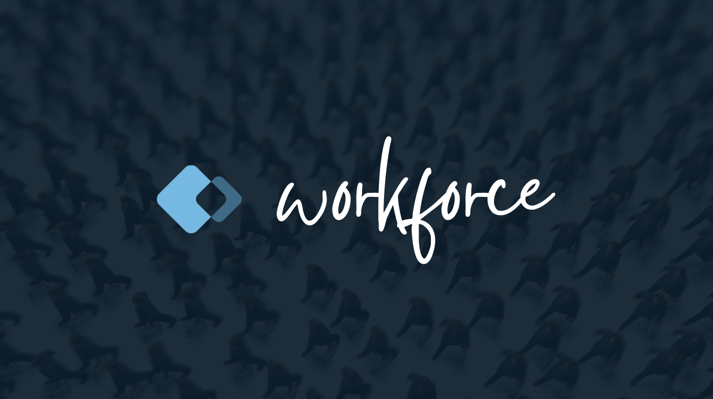

Define an agent’s job, tools, permissions and connections once, then run it locally or through a hosted runtime. The agent separately declares the events and schedules that wake it.

## Get started

See the [repository guide](docs/repository-guide.md) for persona formats, runtime behavior, SDK usage and deployment.
